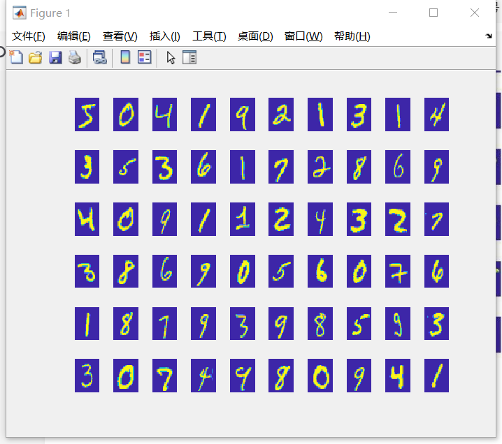
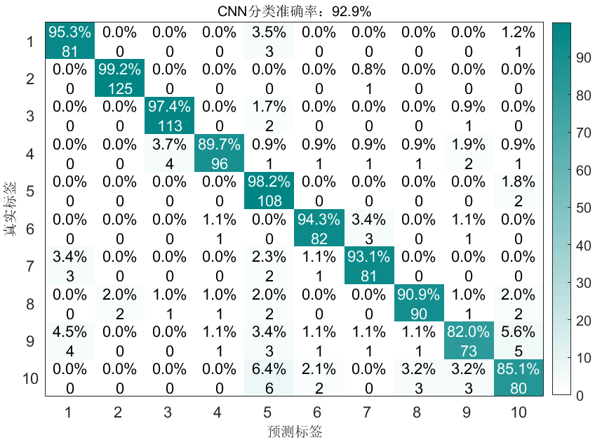
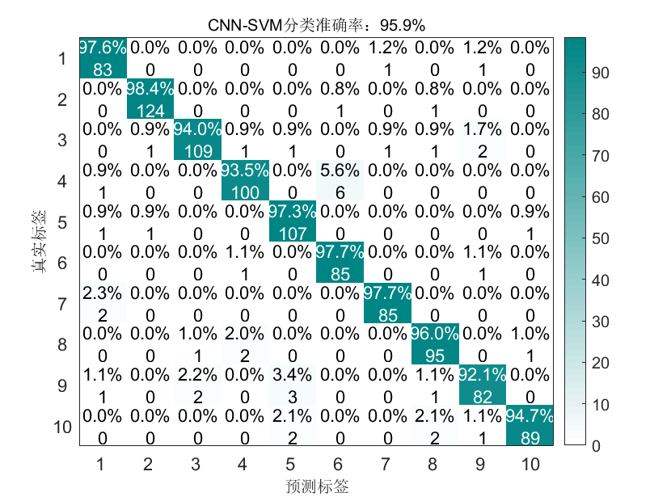
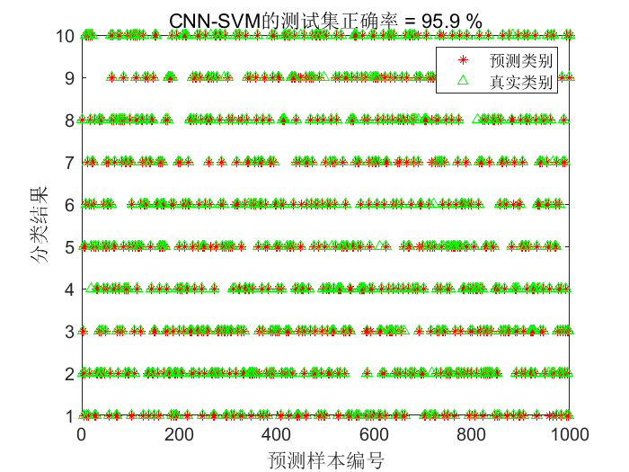
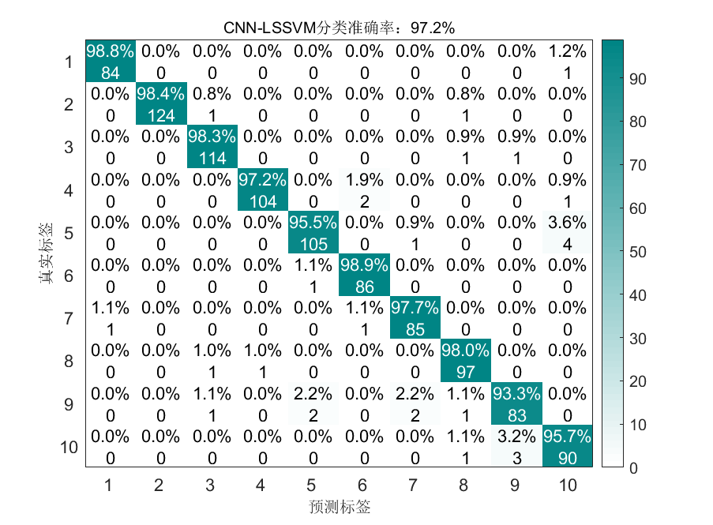
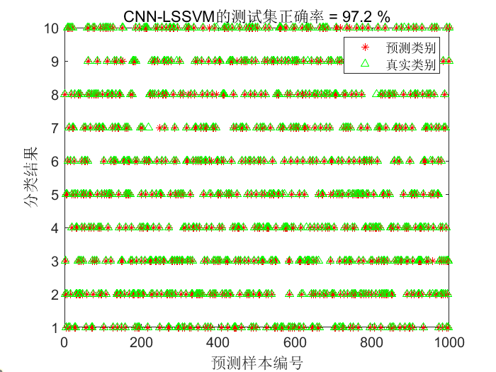
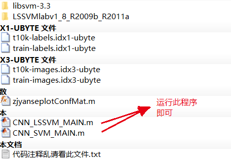

# Handwritten Digit Image Recognition Based on CNN-SVM/LSSVM, MNIST dataset, MATLAB code implementation

The process is as follows:
1. Use CNN to classify the MNIST dataset;
2. Use CNN to extract features from the MNIST handwritten digits images, then use SVM to classify the extracted features;
3. Use CNN to extract features from the MNIST handwritten digits images, then use LSSVM to classify the extracted features;
I. Introduction to the MNIST dataset
Training set: train-images-idx3-ubyte.gz (9.45 MB, containing 60,000 samples).
Training set labels: train-labels-idx1-ubyte.gz (28.2 KB, containing 60,000 labels).
Test set: t10k-images-idx3-ubyte.gz (1.57 MB, containing 10,000 samples).
Test set labels: t10k-labels-idx1-ubyte.gz (4.43 KB, containing 10,000 sample labels).
The following MATLAB code processes the MNIST dataset:
clear all;\nclose all;\nclear\n%% %% The original data has 60,000 training sets and 10,000 test sets. Since SVM needs to be optimized, when the data is too large,\n% The program will run slowly, so it is sufficient to randomly select some data to verify the accuracy of the method.\n% Select 6000 training sets and 1000 test sets.\nN_sample = 6000;\nN_test=1000;\nXTrain = zeros(28,28,1,N_sample);\nYTrain=zeros(N_sample,1);\n\nfidimg1=fopen('train-images.idx3-ubyte','rb');\nfidimg2=fopen('train-labels.idx1-ubyte','rb');      \n\n[img,count]=fread(fidimg1,16);   % table head\n[imgInd,count1]=fread(fidimg2,8);   %table head\nfor k=1:N_sample    \n    [im,~]=fread(fidimg1,[28,28]);\n    ind=fread(fidimg2,1);\n    XTrain(:,:,1,k)=im';\n    YTrain(k)=ind;\nend\nfclose(fidimg1);\nfclose(fidimg2);\nYTrain=categorical(YTrain);\n\nXTest = zeros(28,28,1,N_test);\nYTest=zeros(N_test,1);\nfidimg1=fopen('t10k-images.idx3-ubyte','rb');\nfidimg2=fopen('t10k-labels.idx1-ubyte','rb');\n\n[img,count]=fread(fidimg1,16);\n[imgInd,count1]=fread(fidimg2,8);\nfor k=1:N_test    \n    [im,~]=fread(fidimg1,[28,28]);\n    ind=fread(fidimg2,1);\n    XTest(:,:,1,k)=im';\n    YTest(k)=ind;\nend\nfclose(fidimg1);\nfclose(fidimg2);\nYTest=categorical(YTest);\n\n%% Image Visualization\n% ……………………Picture Visualization……………………\n% Note: The original training set has 60,000 samples, but here we only take the first 60.\nfor i = 1:60\n    img = XTrain(:,:,1,i);\n    subplot(6,10,i)\n    image(img);\n    ax=gca;\n    ax.XAxis.Visible='off';\n    ax.YAxis.Visible='off';\nend\nThe above code implements the following:MINISTThe dataset is divided into training set and test set, and some images are selected for visualization. The visualization results are as follows.:   
II. CNN Classification Results
III. CNN-SVM Classification Results
IV. CNN-LSSVM Classification Results
V. Code Directory
All mentioned images and codes can be run here.

## Images

<!-- PAYMENT_BLOCK -->

## Get this dataset

- Payment link (Stripe): [Buy now](https://buy.stripe.com/3cs8yP7sY87d0vu9AB)
- Payment QR code: 

<!-- /PAYMENT_BLOCK -->
